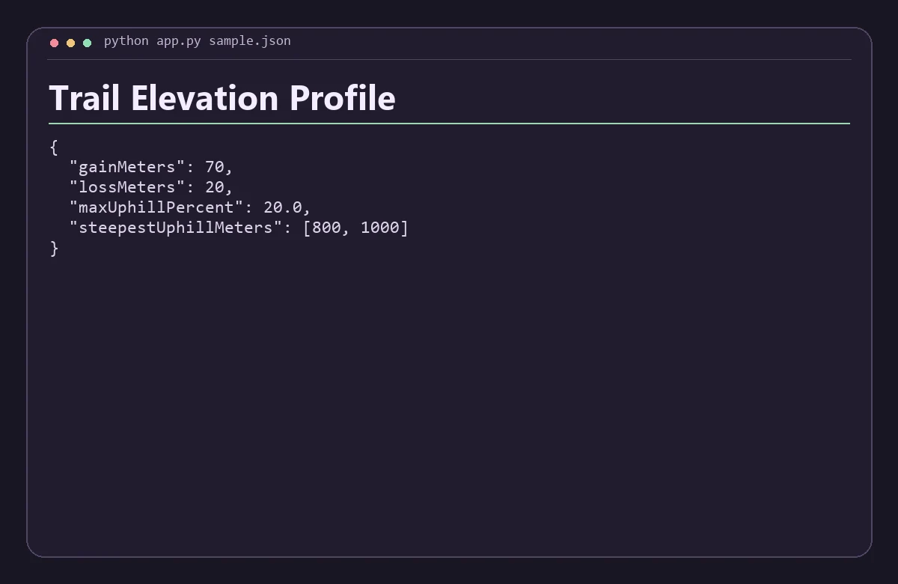

# Trail Elevation Profile

Summarize an elevation profile and identify the steepest uphill section.



## Run

Install Python 3.11 or newer. Run these commands from the repository root.

```sh
python app.py sample.json
```

Replace `sample.json` with a JSON file following the same structure. The app prints a JSON report to standard output.

Give at least two [horizontal distance, elevation] pairs in meters, ordered by increasing distance. Gain and loss sum sample-to-sample changes.

## Verify

Run `python check.py` with Python 3.11 or newer after the build step when applicable. The check verifies the bundled scenario and confirms that an invalid input returns an error.
